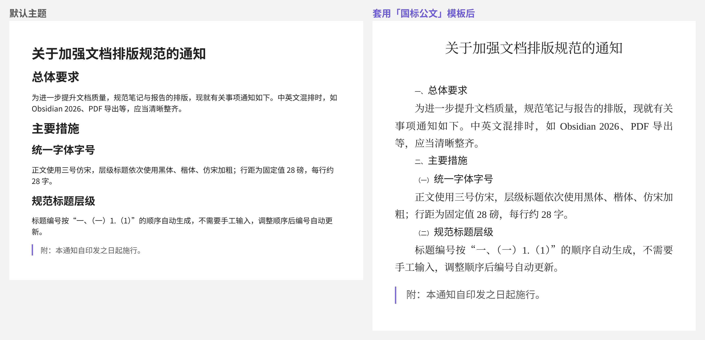
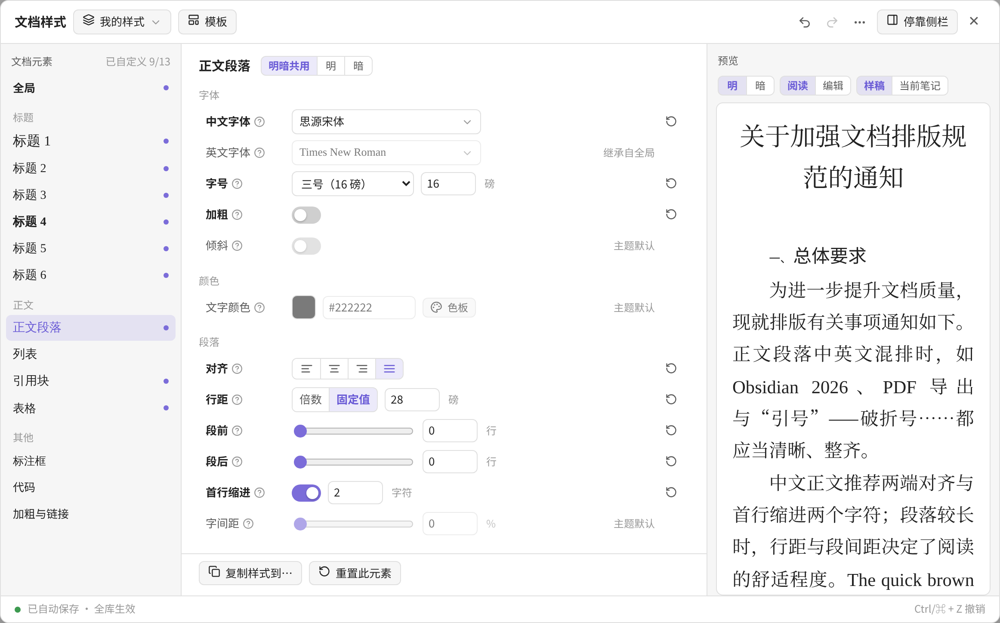

# 版心 · 中文排版

**Banxin – Chinese Typography for Obsidian** · 作者 Simon 老陈

> 版心：排版术语，指一页纸上排放正文的区域。

像 Word 一样，用图形界面设置 Obsidian 笔记的标题、正文、引用、表格等样式：中文字号、中英文分字体、行距（倍数 / 固定值）、段前段后、首行缩进、标题自动编号，以及国标公文、学术论文等现成模板。**不用写一行 CSS。**

*Word-like typography for Obsidian, built for Chinese writing: CJK/Latin font pairing, Chinese font sizes (三号, 小四…), fixed line spacing, first-line indent, automatic heading numbering, and ready-made templates (official documents, theses, comfortable reading). No CSS required.*



## 适合谁

- 用 Obsidian 起草通知、报告、方案的人：套用「国标公文」模板，写完即接近正式文件格式，导出 PDF 不用再回 Word 重排。
- 写论文的人：宋体小四、1.5 倍行距、章节编号 1 / 1.1 / 1.1.1，一键套用。
- 长文和读书笔记作者：更舒适的中文字体、行距和每行字数。

## 主要功能

| 功能 | 说明 |
| --- | --- |
| 全局层 | 在「全局」里选一次中文字体，所有标题和正文一起变化；个别元素再单独调整。继承关系：主题 → 全局 → 元素 |
| 中文字号 | 初号到六号，或直接填磅值。12 磅（小四）= Obsidian 设置里的正文字号 |
| 中英文分字体 | 汉字用中文字体、字母数字用英文字体，自动拼合；加粗调用真正的粗体字面；中文引号、破折号、省略号可交给中文字体（全角） |
| 行距 | 倍数行距或固定值（磅），与 Word 相同 |
| 段前 / 段后 / 首行缩进 | 以「行」「字符」为单位；阅读视图、编辑视图、导出 PDF 都生效 |
| 标题自动编号 | 公文式（一、（一）1.（1））或论文式（1 / 1.1 / 1.1.1），只在显示时生成，不改动笔记原文 |
| 模板 | 国标公文、学术论文、舒适阅读；缺少字体时提示并给出替代字体 |
| 样式集 | 可保存多套样式，一键切换；可导入 / 导出 JSON 与他人分享 |
| 按笔记使用 | 指定某篇笔记使用另一套样式集，其余笔记不受影响 |
| 撤销 / 重做 | Ctrl/⌘ + Z、Ctrl/⌘ + Shift + Z；重置等操作的提示里也有「撤销」按钮 |
| 明暗模式 | 默认明暗共用；也可分别设置。颜色对比度不足时提示，色板会把看不清的颜色置灰 |



## 安装

**手动安装**

1. 下载 `banxin-0.5.0.zip` 并解压，得到 `banxin` 文件夹（内含 `main.js`、`manifest.json`、`styles.css`）。
2. 把整个文件夹放到笔记库的 `.obsidian/plugins/` 目录下。
3. 重启 Obsidian 或在「设置 → 第三方插件」里刷新，启用「版心 · 中文排版」。

需要 Obsidian 1.4 及以上的桌面版。

## 使用

1. 点左侧边栏的 ¶ 图标，或在命令面板运行「版心 · 中文排版：打开样式编辑器」。
2. 第一次打开会显示欢迎页：选一个模板开始，或选「保持主题，自己调」。
3. 左边选元素，中间改属性，右边实时预览。每一行旁边的问号有说明。
4. 想边改边看真实笔记，点右上角「停靠侧栏」。

常用命令：

- **编辑光标所在元素的样式**：光标放在某个二级标题上运行，编辑器直接选中「标题 2」。
- **给当前笔记指定样式集**：这篇笔记改用选中的样式集（写入 frontmatter 的 `cssclasses`）。
- **取消当前笔记的单独样式集**
- **切换样式集**、**套用模板**、**撤销上一次样式修改**

## 常见问题

**字体菜单里没有我装的字体？**
插件通过系统接口读取本机字体，个别系统或 Obsidian 版本读不到时，会显示常用字体列表。可以点「手动输入字体名」直接填写，中文名、英文名都可以。

**提示「未安装」，或公文模板缺字体？**
方正小标宋、仿宋_GB2312、楷体_GB2312 等公文字体需要自行安装（部分为商业字体，请使用有授权的版本）。套用模板时会自动建议可用的替代字体，以后装好原字体，在字体菜单里换回即可。

**和主题冲突、样式没生效？**
在设置里打开「降低优先级以兼容主题」，主题自带的排版细节会优先于插件。也可以先在「全局」里只改字体，确认生效后再逐项调整。

**停用插件后会怎样？**
笔记恢复主题原样；设置会保留，重新启用即恢复。插件不会修改笔记正文（只有「给当前笔记指定样式集」会在 frontmatter 里写入一个类名）。

**从 0.1 升级会丢设置吗？**
不会。旧设置自动迁移：原来的「段间距」拆成段前、段后各一半，其余保持不变。

## 已知限制

- 编辑视图里，段前段后只对正文段落和标题生效；引用块、列表的段距只在阅读视图和导出 PDF 中生效（界面上有标注）。
- 按笔记使用的样式集里没有设置的属性，会沿用全库样式集的设置，而不是回到主题默认。
- 编辑视图的段距用内边距实现，与阅读视图的外边距在相邻段落之间的合并方式不同，视觉上可能略有差异。

## 开发

```bash
npm install
npm run build     # 类型检查 + 打包，生成 main.js
npm test          # 单元测试：生成器快照、单位换算往返、清洗、迁移、编号
npm run dev       # 监听模式
```

浏览器验证：`scripts/harness/` 用一个 Obsidian API 替身在 Chromium 中加载真实界面，逐项检查字号是否叠乘、撤销、模板、编号等（需要 Playwright）。

```bash
npx esbuild scripts/harness/entry.ts --bundle --format=iife --outfile=scripts/harness/harness.js --alias:obsidian=./scripts/harness/obsidian-shim.ts
node scripts/harness/run.mjs /tmp/shots
```

源码结构：

```
src/
  main.ts               插件入口、命令、样式集、按笔记套用、设置页
  constants.ts          元素注册表（所有选择器集中于此）、字号、色板、字体别名
  schema.ts             数据结构、清洗、版本迁移、导入导出
  resolve.ts            继承解析（主题 → 全局 → 元素）
  units.ts              单位换算（读写互逆）、对比度
  store.ts              样式仓库：唯一数据源、撤销栈、变更广播
  css/generator.ts      CSS 生成器（纯函数）
  css/fontface.ts       中英文分字体 @font-face
  numbering*.ts         标题编号（计算 / 阅读视图 / 编辑器装饰）
  fonts.ts  probe.ts    本机字体、主题取值
  templates.ts          内置模板
  ui/                   编辑器、控件、预览、对话框
```

## 关注作者

版心由 **Simon 老陈** 制作。更多排版模板、使用技巧和更新预告，欢迎关注：

- 公众号：**数字化流程再造**
- 小红书：**数字化流程再造**

遇到问题、想要新的模板，也欢迎在公众号或小红书留言。

## 许可

MIT © 2026 老陈。可以自由使用、修改和再发布，请保留原作者署名与版权声明。
